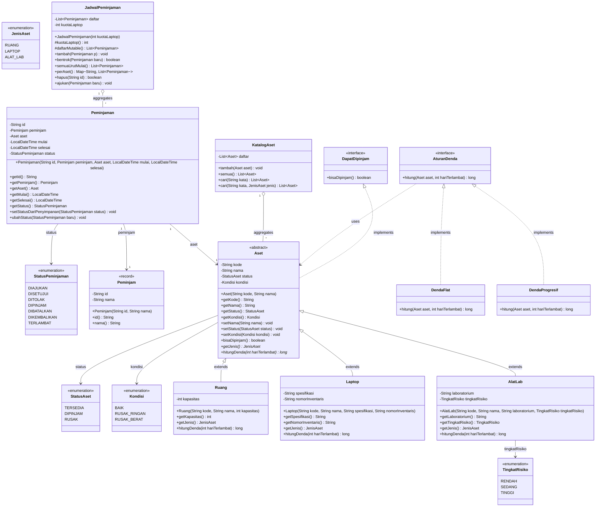

# Class Diagram: Sistem Aset-Pinjam

Diagram kelas ini memodelkan arsitektur berorientasi objek sistem **Aset-Pinjam** pada modul `core` (minggu 1 sampai 6). Model mencakup seluruh atribut, metode, tipe data, tingkat visibilitas, hubungan pewarisan, implementasi antarmuka, serta relasi agregasi dan asosiasi antar-paket.

## 1. Diagram UML (Mermaid)

---

## 2. Struktur Paket dan Penjelasan Komponen

### A. Paket `id.ac.upb.asetpinjam.kontrak`
1. **`DapatDipinjam`**: Antarmuka yang mendefinisikan kemampuan entitas untuk diverifikasi ketersediaannya sebelum dipinjam via `bisaDipinjam()`.
2. **`AturanDenda`**: Antarmuka pola strategi (*Strategy Pattern*) untuk kalkulasi denda keterlambatan aset.

### B. Paket `id.ac.upb.asetpinjam.model`
1. **`Aset`**: Kelas abstrak induk yang merepresentasikan semua aset kampus. Menerapkan enkapsulasi untuk `kode`, `nama`, `status`, dan `kondisi`, serta menyediakan metode abstrak `getJenis()` dan `hitungDenda(int)`.
2. **`Ruang`**: Subclass `Aset` untuk peminjaman ruangan dengan atribut khusus `kapasitas` (multiplier denda 1x).
3. **`Laptop`**: Subclass `Aset` untuk peminjaman laptop dengan atribut `spesifikasi` dan `nomorInventaris` (multiplier denda 2x).
4. **`AlatLab`**: Subclass `Aset` untuk instrumen laboratorium dengan atribut `laboratorium` dan `tingkatRisiko` (multiplier denda 4x).
5. **`Peminjam`**: Record data peminjam (`id` dan `nama`).
6. **`Peminjaman`**: Entitas transaksi peminjaman yang mengaitkan `Peminjam`, `Aset`, rentang waktu (`mulai`, `selesai`), dan siklus `StatusPeminjaman`.

### C. Paket `id.ac.upb.asetpinjam.denda`
1. **`DendaFlat`**: Strategi perhitungan denda dengan tarif flat harian (`aset.hitungDenda(hari)`).
2. **`DendaProgresif`**: Strategi perhitungan denda progresif di mana denda bertambah secara berjenjang seiring lamanya keterlambatan.

### D. Paket `id.ac.upb.asetpinjam.katalog`
1. **`KatalogAset`**: Pengelola koleksi aset di memori dengan fungsionalitas pencarian berlebih (*method overloading*) berdasarkan nama dan jenis.

### E. Paket `id.ac.upb.asetpinjam.jadwal`
1. **`JadwalPeminjaman`**: Pengelola jadwal dan reservasi peminjaman di memori, mencakup deteksi bentrok waktu dan batas kuota laptop.
