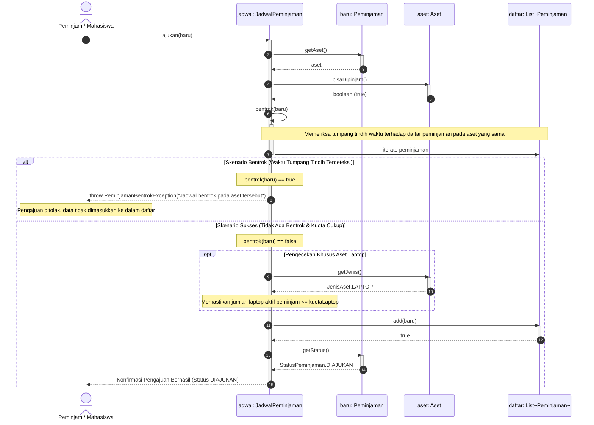

# Sequence Diagram: Pengajuan Peminjaman Aset

Diagram sekuensial ini memodelkan interaksi antar-objek dalam alur proses pengajuan peminjaman aset (`JadwalPeminjaman.ajukan(Peminjaman baru)`). Diagram ini menampilkan dua skenario utama menggunakan fragmen **`alt`**:
1. **Skenario Bentrok (*Conflict Scenario*)**: Jadwal aset yang diminta bertabrakan dengan jadwal peminjaman yang sudah ada sebelumnya.
2. **Skenario Sukses (*Success Scenario*)**: Aset tersedia, waktu peminjaman valid tanpa bentrok, dan kuota peminjam mencukupi.

---

## 1. Diagram Sekuensial (Mermaid)

---

## 2. Rincian Alur Interaksi

1. **Pemanggilan Awal**:
   Aktor pemohon memanggil metode `ajukan(baru)` pada objek `JadwalPeminjaman` dengan mengirimkan objek instans `Peminjaman`.
2. **Verifikasi Kelayakan Aset**:
   Objek jadwal mengambil referensi aset dari objek peminjaman (`baru.getAset()`), kemudian memanggil metode `bisaDipinjam()` untuk memastikan status aset adalah `TERSEDIA` dan kondisi fisiknya bukan `RUSAK_BERAT`.
3. **Pemeriksaan Bentrok Waktu**:
   Jadwal mengeksekusi metode internal `bentrok(baru)` dengan membandingkan rentang waktu `mulai` hingga `selesai` terhadap riwayat peminjaman aset terkait yang ada di dalam koleksi `daftar`.
4. **Percabangan Fragmen `alt`**:
   - **Kasus Bentrok**: Jika ditemukan peminjaman aktif lain pada rentang waktu yang beririsan untuk aset yang sama, `JadwalPeminjaman` segera melempar exception `PeminjamanBentrokException` (atau membatalkan operasi). Alur dihentikan dan data tidak disimpan.
   - **Kasus Sukses**: Jika tidak terjadi bentrok dan kuota peminjaman (khusus laptop) mencukupi, objek peminjaman baru ditambahkan ke dalam koleksi `daftar.add(baru)`. Status peminjaman tercatat sebagai `DIAJUKAN` dan pesan sukses dikembalikan kepada pemohon.
